<div align="center">
  

  # Interface X-Ray
  **See the structure. Find the cause.**

  Visual DOM inspection, spatial layers, evidence-based layout diagnostics, and reversible CSS experiments — within the page you're analyzing.

  **Chrome / Microsoft Edge · Manifest V3 · Local-first · MIT · No telemetry**
</div>

---

<div align="center">
  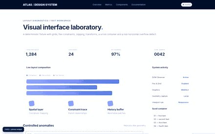
  <p><sub>Actual Chromium interaction capture of the 1.0.0 build. No generated product screenshots.</sub></p>
</div>

## Explore · Diagnose · Fix · Verify

<table>
  <tr><th width="50%">01 — Understand the structure</th><th width="50%">02 — Explode into spatial layers</th></tr>
  <tr><td>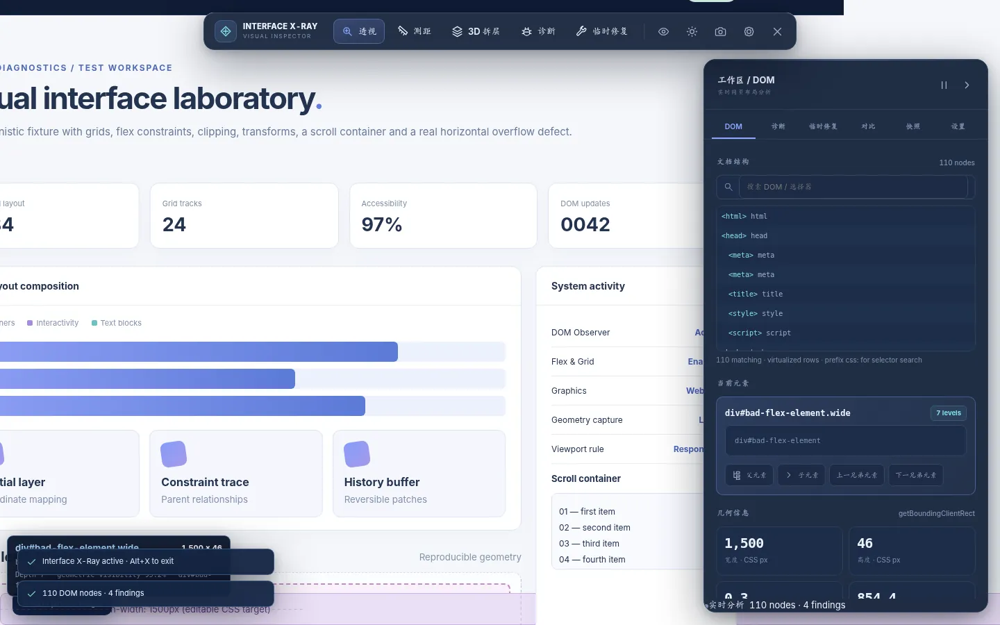</td><td>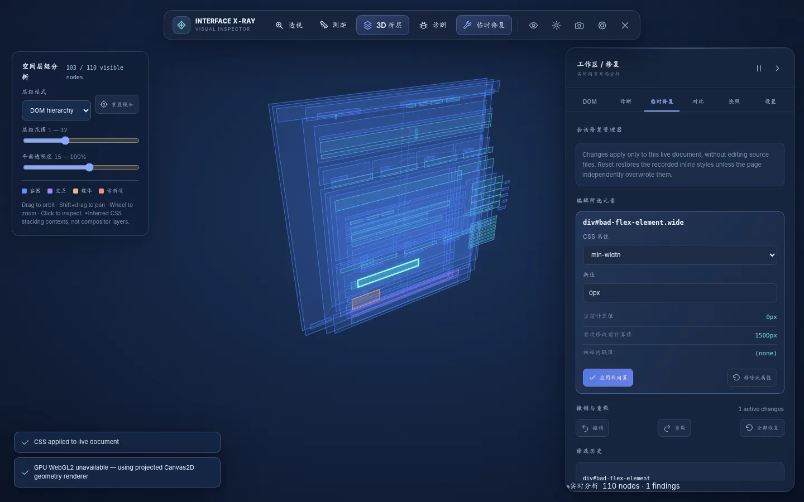</td></tr>
  <tr><td>Inspect actual layout geometry, computed styles, Flex/Grid properties and DOM relationships. Measure distances between elements or highlight clipping boundaries.</td><td>Orbit, zoom, pan, select and refocus DOM planes. Switch between DOM nesting and inferred CSS stacking contexts; choose orthographic or perspective projection.</td></tr>
  <tr><th>03 — Investigate the cause</th><th>04 — Try a reversible change</th></tr>
  <tr><td>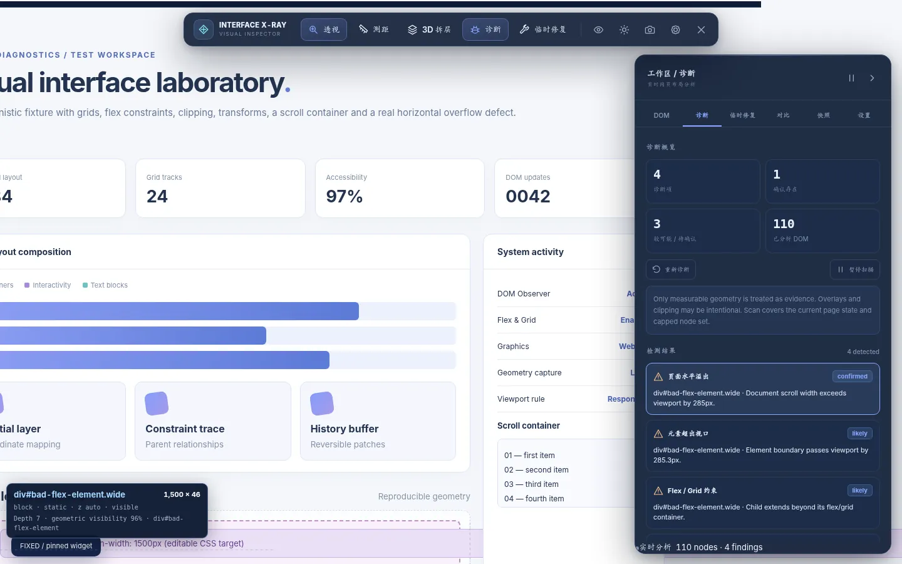</td><td>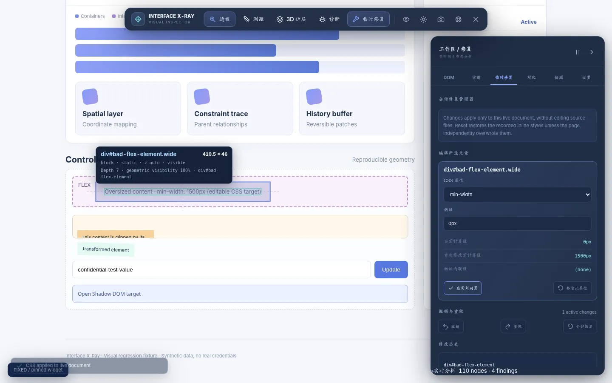</td></tr>
  <tr><td>Inspect measured viewport overflow, clipping, fixed overlays, positioned overlaps and Flex/Grid constraints. View evidence-backed candidate causes, not invented source locations.</td><td>Temporarily edit the selected element. Undo, redo, reset, compare original computed styles and export reusable CSS without modifying the website's files.</td></tr>
  <tr><th>05 — Compare the real layouts</th><th>06 — Inspect responsive behavior</th></tr>
  <tr><td>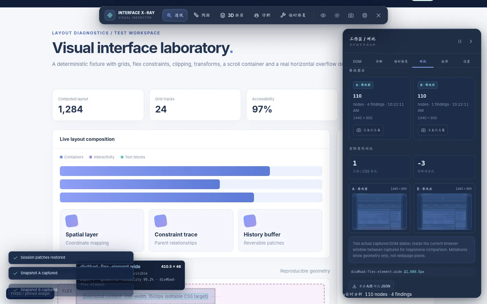</td><td>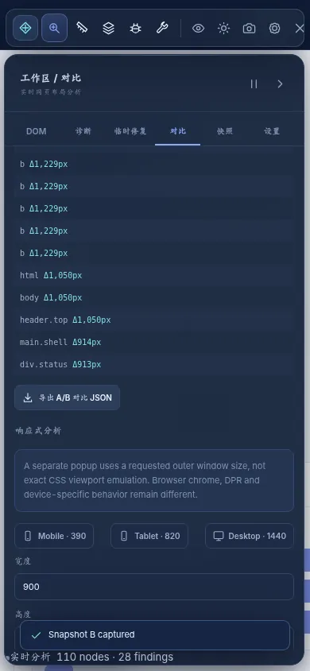</td></tr>
  <tr><td>Snapshot the DOM state before and after a CSS change; compare geometry, visibility, Flex/Grid properties and introduced/resolved findings. Download the complete JSON difference.</td><td>Resize the browser and capture two genuine CSS viewport states (1440px and 390px demonstrated). Side-by-side diagrams visualize measured boxes, not fabricated full-page screenshots.</td></tr>
</table>

<details><summary><b>More real interface screenshots</b></summary>

| Diagnostics | Stacking contexts | Dark/light appearance |
|---|---|---|
| 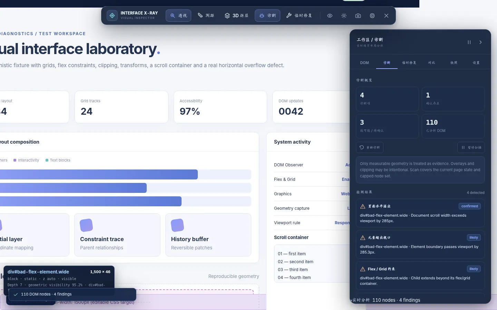 | 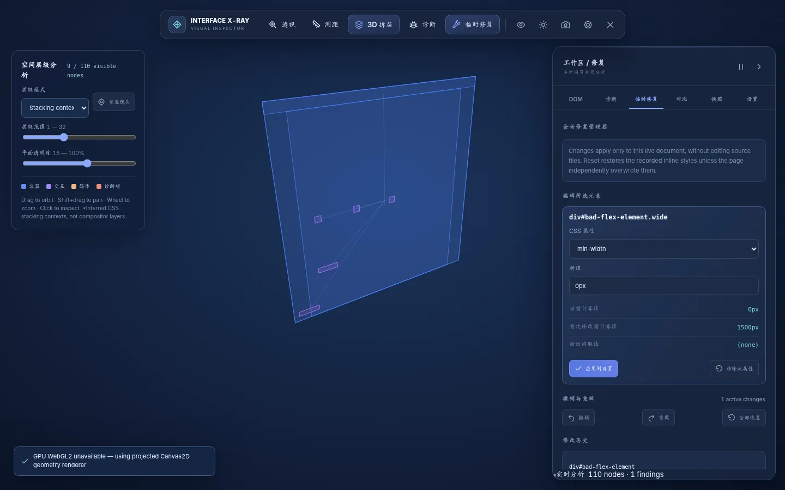 | 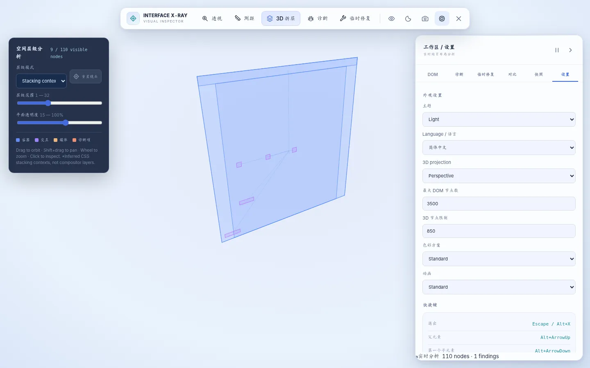 |

| Spacing measurement | Clipping geometry | Large DOM browser |
|---|---|---|
| 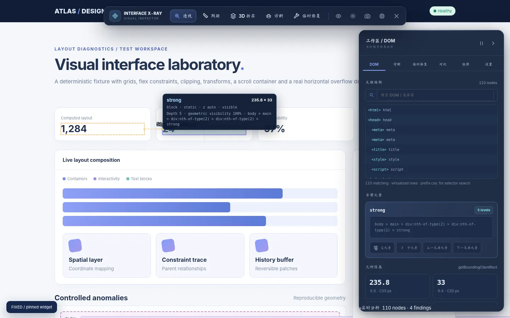 | 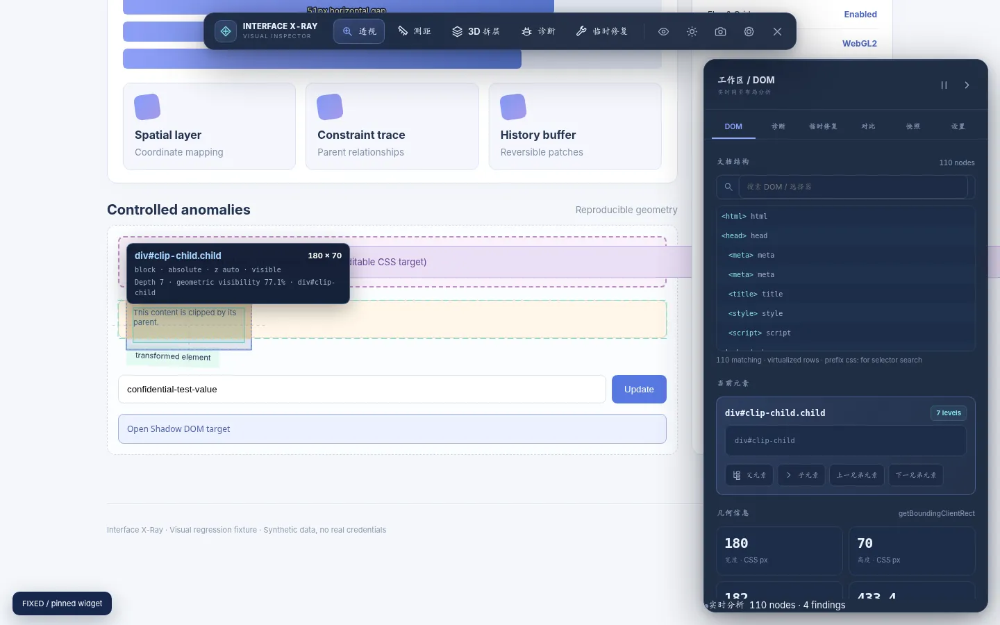 | 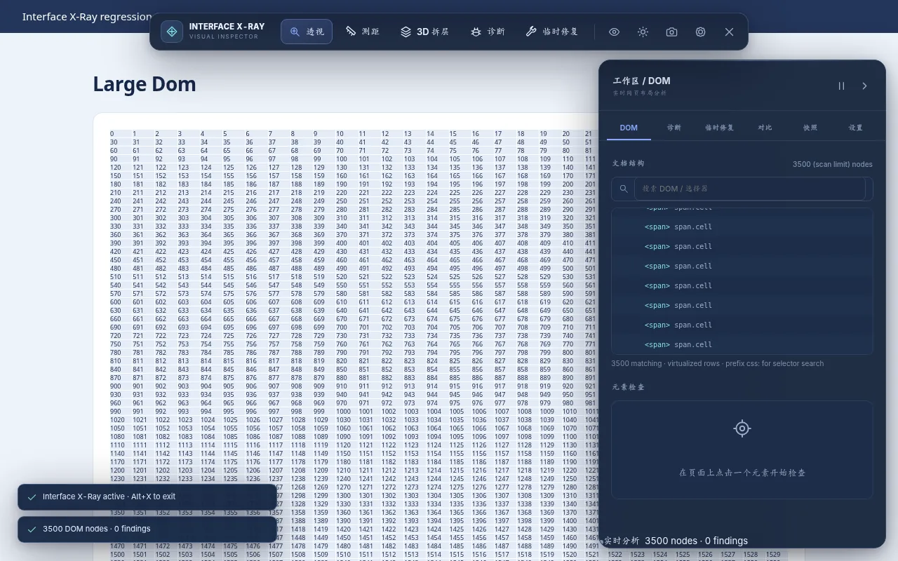 |

| Preferences | 390px viewport | 2× DPI |
|---|---|---|
| 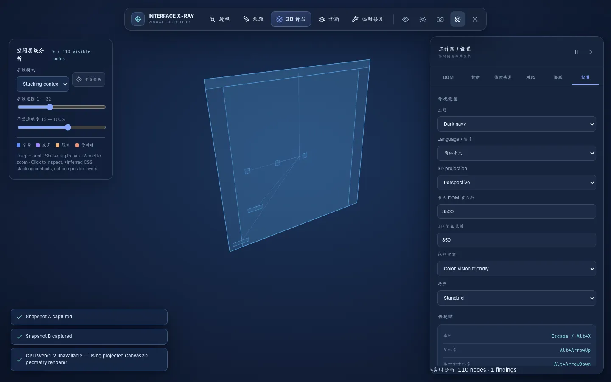 | 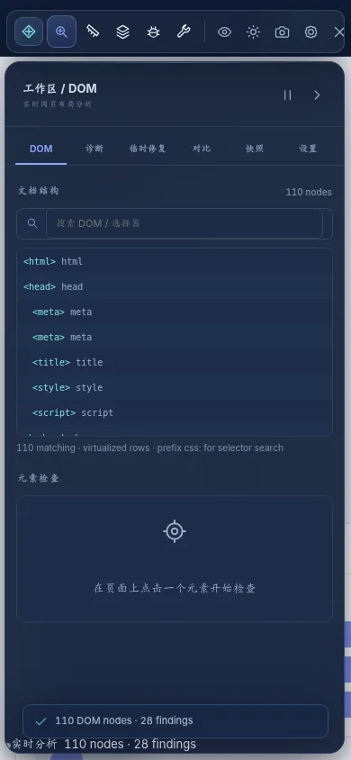 | 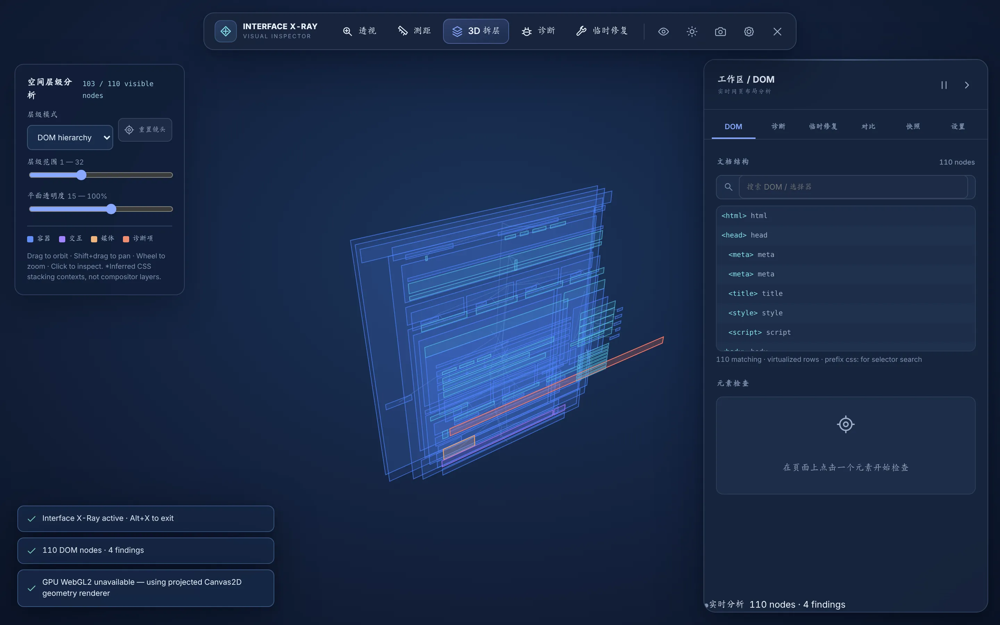 |

</details>

## Install / 安装

**No build tools, account, server, or API key are required to use the extension.**

1. Download the *load-unpacked* release ZIP and extract it.
2. Open `chrome://extensions` in Chrome or `edge://extensions` in Edge.
3. Enable **Developer mode / 开发者模式**.
4. Click **Load unpacked / 加载已解压的扩展程序** and select the folder that contains `manifest.json`.
5. Open a normal web page and click the **Interface X-Ray** browser icon. Click again to close it and restore session CSS edits.

Optional toolbar shortcut: `Alt+Shift+X` (browser-assigned shortcut; may vary). `Shift+M` toggles the on-page spacing measurement tool. `Escape` closes 3D mode first, or exits the inspector.

The extension cannot inject into Chrome/Edge internal pages, extension galleries and other browser-protected locations. Local `file://` access is disabled unless explicitly enabled in your browser's extension settings.

### Build from source

Node.js **20+**, no npm dependencies, no online build step:

```bash
npm run check
npm test
npm run build
```

Open the generated `dist/` folder as an unpacked extension. The code is plain JavaScript, SVG/CSS and a native WebGL2/Canvas2D rendering pipeline, bundled into one content script by a small offline Node build script. **This repository does not claim to use React, TypeScript, Vite or Three.js.**

## Key features

| Area | Actual implementation | Boundary |
|---|---|---|
| Activation | Manifest V3 `activeTab` and `scripting`; only user-clicked tab is injected | Browser-protected pages and cross-origin frames remain restricted |
| 2D analysis | Hover/select, selector display and CSS-search, parent/child/sibling navigation, box model, geometric clipping/scroll boundary | Transformed rectangles use axis-aligned `getBoundingClientRect` bounds |
| Flex / Grid | Layout properties, Flex axes/children and Grid child positions plus computed track lines | Not a complete CSS Grid editor or layout solver |
| Measurement | Two-element distance/overlap visualization, real bounding rectangles | Geometric measurement, not occlusion-aware visual hit-test |
| 3D DOM | Actual measured planes, programmatic camera, node picking, instanced WebGL2 when available, Canvas2D fallback | Geometric representation, not native composited-pixel layers |
| Stacking contexts | Separate inferred context hierarchy with context-parent links | Does not establish exact browser paint order or compositor allocations |
| Diagnostic rules | Document overflow, off-screen geometry, fixed minimum width, clipping, Flex/Grid constraints, fixed overlays, floating overlap, small controls | Confidence levels distinguish measurable facts from potentially intentional design |
| Cause tracing | Evidence-backed hypotheses, CSS/geometry ancestor path, experiments to try | Source-level CSS declaration location is not available |
| CSS experiments | Allowlisted properties, immediate preview, original computed value, undo/redo/reset, export CSS | Page scripts may mutate the same property concurrently |
| Responsive | Genuine A/B geometry snapshots; 390/820/1440 popups; optional current-window resize; JSON diff | Popup outer dimensions differ from CSS viewport; no exact device or touch simulation |
| Large documents | Chunked idle scans, virtualized DOM list, render node caps, open Shadow DOM change observations | A bounded sample, not every node of an unbounded document |
| Export | DOM JSON, diagnosis JSON, comparison JSON, patch CSS, 3D PNG, screenshot with explicit consent/masking | Form masking does not redact arbitrary visible text, embedded frames, images, canvas or video |
| Preferences | Chinese/English primary UI, dark/light, projection, color-vision friendly palette, scan/scene limits | Some informational phrases and technical labels remain English |

## Safety and privacy

The production manifest requests only:

```json
"permissions": ["activeTab", "scripting"]
```

There are no blanket host permissions, remote scripts, external analytics, accounts or outbound report uploads. DOM geometry, selectors and computed layout data are processed in the active page and are exported only when the user chooses to export. JSON exports do not intentionally collect plain text nodes, form values, cookies or passwords. Selectors, IDs and classes **may still contain private information**.

Browser screenshots may capture sensitive text. Export requests trigger an explicit privacy confirmation and an optional geometric mask over common form controls. **This is not full personal-information redaction.** Review screenshots before sharing them. See [PRIVACY.md](PRIVACY.md) and [SECURITY.md](SECURITY.md).

## Verify locally

```bash
npm run check
npm test
python tests/scenarios.py
python tests/e2e.py
python tests/release_qa.py
python tests/measure_qa.py
python tests/responsive_qa.py
python tests/visual_qa.py
```

The Python test harness needs `playwright` and an installed Chromium-family browser. Set `CHROMIUM_PATH` to an executable path if necessary, or install Playwright's bundled Chromium. The release video can be re-recorded from real Chromium using `python tests/record_release.py` (optional FFmpeg conversion to MP4/GIF).

**What was verified:** local Chromium injection tests, the live inspector workflow, 13 reproducible HTML layout scenarios, 24 additional release-gate checks, spacing/clipping interactions, genuine 1440px→390px A/B capture, 390/768/1440px geometry checks, 2× device-pixel-ratio canvas sizing, and real screen recording. See [TEST_REPORT.md](TEST_REPORT.md) for executed results.

**What could not be verified in this environment:** invoking the extension through a native Chrome/Edge toolbar click on external HTTPS sites, native `captureVisibleTab`, Windows/Edge installation, and the WebGL2 GPU shader path (all attempted Chromium configurations returned no WebGL context; the tested scene used projected Canvas2D). Those are explicitly **not** marked as passing tests or hidden behind a mock result.

## Architecture

```text
Interface-X-Ray/
├── dist/                    # immediately loadable MV3 extension
├── src/
│   ├── background.js        # action activation and privileged screenshot/window requests
│   ├── bootstrap.js         # lifecycle, listeners and Shadow DOM UI
│   ├── core.js              # state, selectors and shared geometry
│   ├── inspect.js           # scanning, 2D overlays, Grid/Flex and measurement
│   ├── diagnose.js          # measurable rules, evidence, cause tracing
│   ├── patch.js             # allowlisted session CSS changes and history
│   ├── scene.js             # 3D instanced WebGL2 and projected Canvas2D
│   ├── ui.js                # inspector, diagnostic, patch and comparison workspaces
│   └── ui.css               # light/dark isolated visual system
├── scripts/                 # deterministic offline build and fixtures
├── tests/                   # unit, scenario, E2E, responsive and visual checks
├── screenshots/             # authentic Chromium test captures
├── media/                   # actual Chromium recorded GIF / MP4 / WebM
├── manifest.json
├── PRIVACY.md
├── SECURITY.md
├── ARCHITECTURE.md
├── TEST_REPORT.md
└── LICENSE
```

## Prior art

This project does **not** claim to have invented 3D DOM inspection. Relevant established work includes [Microsoft Edge DevTools 3D View](https://learn.microsoft.com/en-us/microsoft-edge/devtools/3d-view/), [VisBug](https://github.com/GoogleChromeLabs/ProjectVisBug), [Strata — 3D DOM Exploder](https://chromewebstore.google.com/detail/strata-3d-dom-exploder/dcdkchlpolonabedodajfiklacbplcag), and Chrome DevTools Elements/Layout. Interface X-Ray focuses on a joined process: **inspect → measure → trace → patch → compare → export**.

MIT licensed. Contributions and reproducible layout failures are welcome; read [CONTRIBUTING.md](CONTRIBUTING.md).
